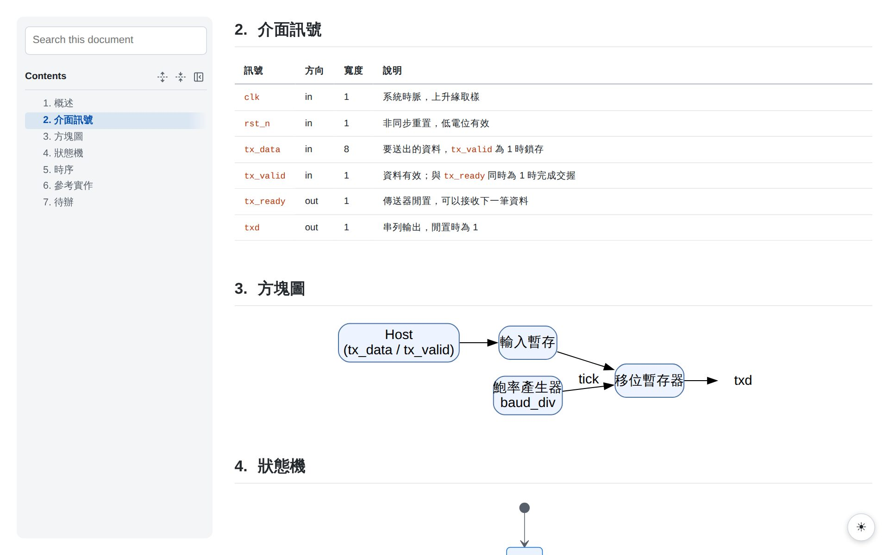
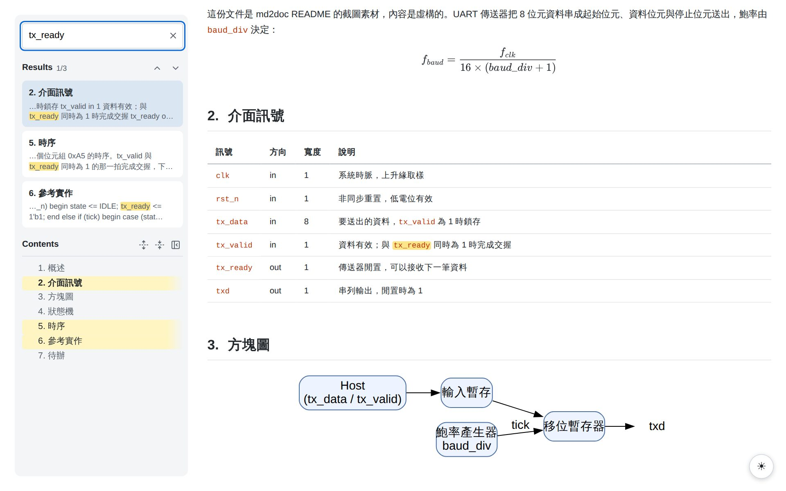
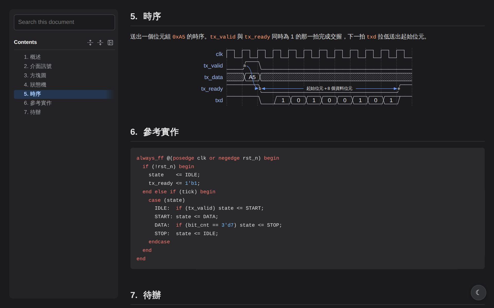
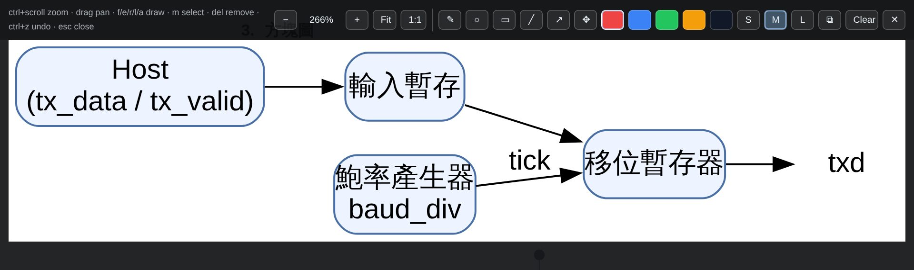
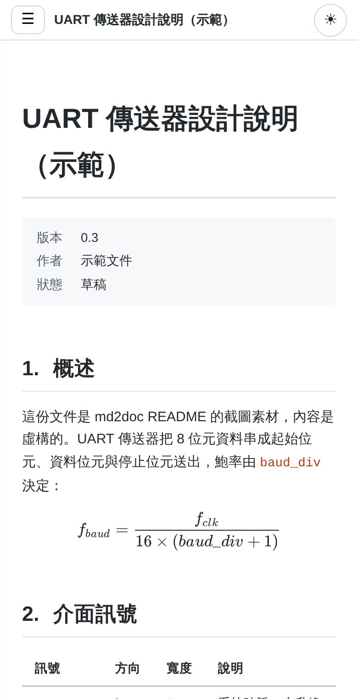
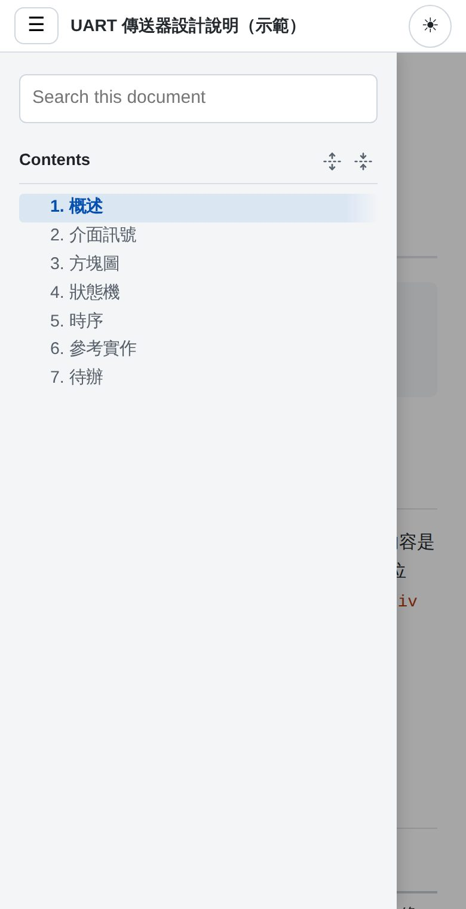
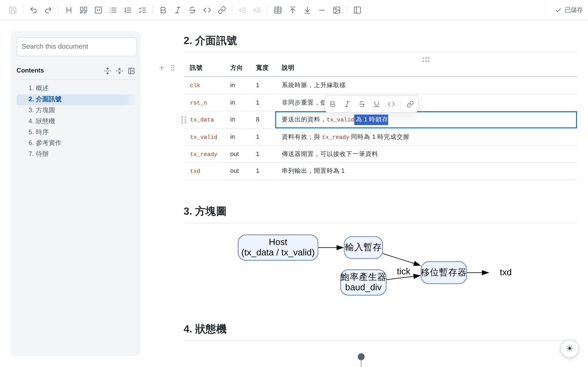
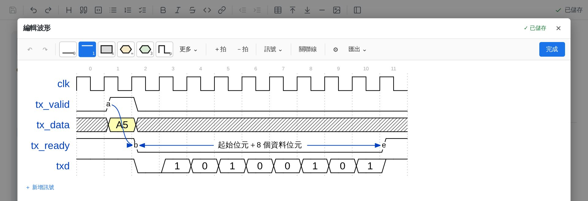
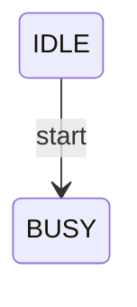
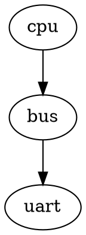

# md2doc

**把 Markdown 轉成一份單檔 HTML 或 PDF：時序圖、狀態圖、方塊圖、公式直接畫好，離線就能看。**

<p align="center">
  
</p>
<p align="center"><sub>轉出來的 HTML：左邊目錄跟著閱讀位置走，表格、程式碼、四種圖都排好了。截圖用的是虛構的示範文件。</sub></p>

md2doc 是一個命令列工具（`md2doc`），在哪個資料夾都能用。輸出是**一個檔案**：圖片、字型、圖表引擎全包在裡面，
寄出去、丟進共用資料夾、斷網打開都一樣。加上 `--edit`，同一份文件可以直接在瀏覽器裡改，存回原本的 `.md`。

目前版本見 [CHANGELOG.md](CHANGELOG.md)。

---

## 它幫你解決什麼

| 麻煩 | md2doc 怎麼處理 |
|---|---|
| 規格書裡的時序圖、狀態圖要另外畫、另外貼 | 在 Markdown 裡寫 `wavedrom`、`mermaid`、`dot` 程式碼區塊，或引用 `.drawio` 檔，轉檔時直接畫進去 |
| 轉出來的 HTML 一寄出去圖就破 | 本機圖片轉成 base64 內嵌，圖表引擎也內嵌；不連 CDN、不用裝 Graphviz 或 draw.io |
| 長文件找不到東西 | 側欄目錄跟著閱讀位置展開；全文搜尋會在內文標出每一筆 |
| 圖太小看不清楚 | 點一下圖就全螢幕開啟，可以縮放、平移，還能直接畫圈、畫箭頭做標註 |
| 晚上看白底很刺眼 | 右下角 ☀／☾ 切深色，圖表跟著變深；列印和 PDF 一律淺色 |
| 改一個字就要開編輯器、再轉一次 | `md2doc --edit`：點哪裡就改哪裡，波形圖有自己的編輯器，Ctrl+S 存回 `.md` |
| 編輯器把整份檔案重新排版、diff 一大片 | 只改你動過的那幾行，其他每個位元組都不變 |

---

## 三步開始

**1. 安裝**（需要 Node.js 18 以上）

```bash
npm install -g @helping-ai-workflow/md2doc
```

第一次安裝會下載 Chromium（約 170 MB），只有轉 PDF、`--bake-svg` 和 `.drawio` 圖會用到。
還沒有 Node.js，或安裝時出現 `EACCES`，見下方[常見問題](#安裝時出現-eacces-permission-denied)。

**2. 轉檔**

```bash
md2doc spec.md                     # 轉成 HTML 並直接打開
md2doc spec.md --out spec.html     # 寫到指定的檔案
md2doc --pdf spec.md               # 轉成 PDF
```

**3. 想改內容就加 `--edit`**

```bash
md2doc --edit spec.md
```

瀏覽器會開一個只有本機連得到的編輯頁，改完按 Ctrl+S 存檔。

---

## 介面一覽

<table>
  <tr>
    <td width="50%"></td>
    <td width="50%"></td>
  </tr>
  <tr>
    <td><sub><b>搜尋。</b>按 Enter 搜尋，結果列出所在章節，內文與目錄標黃，▲▼ 跳上一筆、下一筆。</sub></td>
    <td><sub><b>深色模式。</b>時序圖、狀態圖跟著變深；程式碼有語法上色（Verilog、Python、C、Tcl 等），滑過區塊出現複製鍵。</sub></td>
  </tr>
  <tr>
    <td colspan="2"></td>
  </tr>
  <tr>
    <td colspan="2"><sub><b>點圖放大。</b>Ctrl＋滾輪縮放、拖曳平移；<code>f</code> 手繪、<code>e</code> 橢圓、<code>r</code> 方框、<code>a</code> 箭頭，⧉ 連同標註一起複製成圖片。Esc 關閉。</sub></td>
  </tr>
</table>

<p align="center">
  
  
</p>
<p align="center"><sub><b>手機。</b>頂列顯示目前章節，☰ 打開目錄；寬的表格左右捲動時，第一欄固定在左邊。</sub></p>

### 編輯模式（`--edit`）

<p align="center"></p>
<p align="center"><sub>點一格就能打字；選取文字浮出 B／I／刪除線／底線／程式碼／連結。右上角顯示存檔狀態。</sub></p>

- **點哪裡改哪裡**：段落、標題、清單、表格格子直接打字，看到的是排版後的樣子，不是 Markdown 符號。
- **區塊左邊的 ⠿ 與 ＋**：⠿ 拖曳排序、刪除、改格式，或開「MD 原始碼」直接改這一塊；＋ 在下方插入新區塊。
- **表格**：Tab 換格、拖格子選範圍、滑過欄列出現握把，可以插入、刪除、拖曳排序。
- **存檔是手動的**：Ctrl+S 才寫回檔案；檔案在別處被改了，頁面會自動重新載入或提示衝突，不會蓋掉別人的修改。

<p align="center"></p>
<p align="center"><sub><b>波形編輯器。</b>滑過時序圖按「編輯」打開。畫布就是輸出的那張圖：點一拍改電位、按住拖曳塗一段、拖圓點拉關聯線，? 看全部快捷鍵。</sub></p>

---

## 圖表與公式怎麼寫

````markdown
```wavedrom
{ "signal": [ { "name": "clk", "wave": "p...." }, { "name": "req", "wave": "01.0." } ] }
```





        <!-- #Flow 選分頁名稱，#2 選第 2 頁 -->

$$ f_{baud} = \frac{f_{clk}}{16 (div + 1)} $$
````

Mermaid 與 WaveDrom 預設在瀏覽器裡畫，加 `--bake-svg` 改成轉檔時就畫成 SVG（輸出裡不帶 JavaScript）。
Graphviz 與 draw.io 一律在轉檔時畫好。本機圖片（``、``、`<picture>`）以 `.md` 所在的資料夾為準，轉檔時內嵌。

---

## 常用參數

| 參數 | 作用 |
|---|---|
| `--out <path>` | 輸出到指定的檔案或資料夾（`./build/`）；副檔名 `.pdf` 就轉 PDF。指定後不自動打開，要打開再加 `--open` |
| `--pdf`、`--html` | 選輸出格式，兩個都加就兩種都轉 |
| `--edit [--port <n>]` | 在瀏覽器裡編輯，可以一次開多個檔案 |
| `--bake-svg` | Mermaid／WaveDrom 在轉檔時就畫成 SVG |
| `--lang <tag>` | 指定 `<html lang>`；不指定時依內容自動判斷（`zh-Hant`、`ja`、`ko`、`en`） |
| `--quiet` | 不印進度 |

`md2doc *.md --out ./build/` 一次轉整個資料夾。完整說明：`md2doc --help`。

---

## 常見問題

### 安裝時出現 `EACCES: permission denied`

系統的 Node.js 裝在 root 的目錄底下。**不要**用 `sudo npm install -g`（Chromium 會以 root 下載，之後執行會壞），改用 [nvm](https://github.com/nvm-sh/nvm) 裝 Node.js：

```bash
curl -o- https://raw.githubusercontent.com/nvm-sh/nvm/master/install.sh | bash
source ~/.zshrc              # 或 ~/.bashrc
nvm install --lts
npm install -g @helping-ai-workflow/md2doc
```

### 安裝時出現 `Failed to set up chrome`

之前的安裝留下下載到一半的 Chromium。刪掉 `~/.cache/puppeteer` 再裝一次：

```bash
rm -rf ~/.cache/puppeteer && npm install -g @helping-ai-workflow/md2doc
```

### 編輯模式會不會把我的格式改掉？

不會。只有你按 Enter、或離開時有改過的區塊會重寫；其他行（包含對齊用的空白、行尾空白、檔尾換行）一個位元組都不動。
你改過的表格會存成最精簡的寫法（`| a | b |`、`|---|`）。

### 在編輯模式裡新增了第一張 Mermaid／WaveDrom 圖或第一個公式，卻沒畫出來？

頁面打開時文件裡沒有這種圖，所以沒載入它的引擎。重新整理瀏覽器分頁就好，不用重開 `md2doc --edit`。

### 轉檔時 stderr 出現 `data labels are wider than their segments`？

WaveDrom 圖裡有資料標籤比它那一段還寬。訊息會說最寬的是哪一個，以及 `config.hscale` 要設多少才放得下；輸出照常產生，exit code 仍是 0。

### 從 md2html／md2pdf（v1.x）升級

`md2html foo.md` 改成 `md2doc foo.md`，`md2pdf foo.md` 改成 `md2doc --pdf foo.md`。
以前輸出會寫在原始檔旁邊，現在預設寫到暫存資料夾；要寫在固定的地方就加 `--out ./build/`。

---

## 開發者資訊

<details>
<summary><b>目錄、測試、截圖</b></summary>

| 路徑 | 內容 |
|---|---|
| `bin/md2doc.js` | 命令列入口 |
| `lib/md2doc.js` | 轉檔主程式（閱讀頁的 HTML、CSS、JavaScript 都在這裡） |
| `lib/editor/` | `--edit` 的本機伺服器與編輯器 |
| `lib/theme/` | 深色模式的配色表與切換 |
| `vendor/drawio/` | 內附的 draw.io viewer（Apache-2.0） |
| `test/` | 測試 |

```bash
npm test                 # 轉檔與編輯器的測試
npm run test:browser     # 在 Chromium 與 WebKit 實際點過閱讀頁和編輯頁
                         # （第一次先跑 npx playwright install chromium webkit）
node docs/readme/shots.js   # 重新產生 README 的截圖（用 docs/readme/demo.md）
```

貢獻規則與發版流程見 [CLAUDE.md](CLAUDE.md)。

</details>

---

## 授權

md2doc 本身是 **MIT**，見 [`LICENSE`](LICENSE)。

npm 套件裡另外附了一個第三方檔案：`vendor/drawio/viewer-static.min.js`（draw.io／diagrams.net viewer v31.3.2），授權是 **Apache License 2.0**，
授權全文與 NOTICE 在 [`vendor/drawio/`](vendor/drawio/)。要做授權掃描，從 [`THIRD-PARTY-NOTICES.md`](THIRD-PARTY-NOTICES.md) 開始看。
