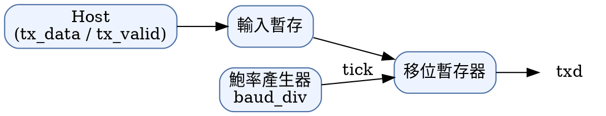
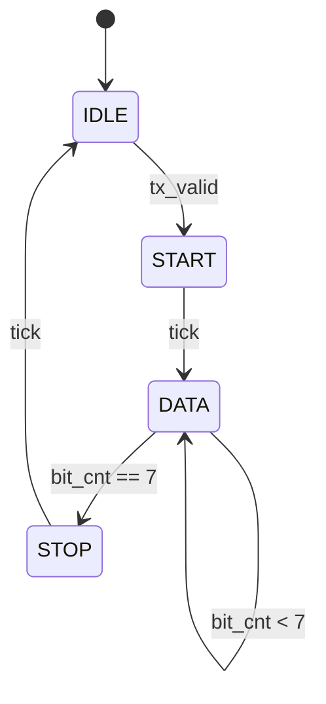

# UART 傳送器設計說明（示範）

**版本:** 0.3
**作者:** 示範文件
**狀態:** 草稿

## 1. 概述

這份文件是 md2doc README 的截圖素材，內容是虛構的。UART 傳送器把 8 位元資料串成起始位元、資料位元與停止位元送出，鮑率由 `baud_div` 決定：

$$
f_{baud} = \frac{f_{clk}}{16 \times (baud\_div + 1)}
$$

## 2. 介面訊號

| 訊號 | 方向 | 寬度 | 說明 |
|---|---|---|---|
| `clk` | in | 1 | 系統時脈，上升緣取樣 |
| `rst_n` | in | 1 | 非同步重置，低電位有效 |
| `tx_data` | in | 8 | 要送出的資料，`tx_valid` 為 1 時鎖存 |
| `tx_valid` | in | 1 | 資料有效；與 `tx_ready` 同時為 1 時完成交握 |
| `tx_ready` | out | 1 | 傳送器閒置，可以接收下一筆資料 |
| `txd` | out | 1 | 串列輸出，閒置時為 1 |

## 3. 方塊圖



## 4. 狀態機



## 5. 時序

送出一個位元組 `0xA5` 的時序。`tx_valid` 與 `tx_ready` 同時為 1 的那一拍完成交握，下一拍 `txd` 拉低送出起始位元。

```wavedrom
{ "signal": [
  { "name": "clk",      "wave": "p..........." },
  { "name": "tx_valid", "wave": "010.........", "node": ".a.........." },
  { "name": "tx_data",  "wave": "x3x.........", "data": ["A5"] },
  { "name": "tx_ready", "wave": "1.0........1", "node": "..b........e" },
  { "name": "txd",      "wave": "1.0========1", "data": ["1","0","1","0","0","1","0","1"] }
],
  "edge": ["a~>b", "b<->e 起始位元＋8 個資料位元"]
}
```

## 6. 參考實作

```verilog
always_ff @(posedge clk or negedge rst_n) begin
  if (!rst_n) begin
    state    <= IDLE;
    tx_ready <= 1'b1;
  end else if (tick) begin
    case (state)
      IDLE:  if (tx_valid) state <= START;
      START: state <= DATA;
      DATA:  if (bit_cnt == 3'd7) state <= STOP;
      STOP:  state <= IDLE;
    endcase
  end
end
```

## 7. 待辦

- [x] 介面訊號定稿
- [x] 狀態機
- [ ] 同位元檢查（parity）
  - [ ] 偶同位
  - [ ] 奇同位
- [ ] 錯誤注入測試
